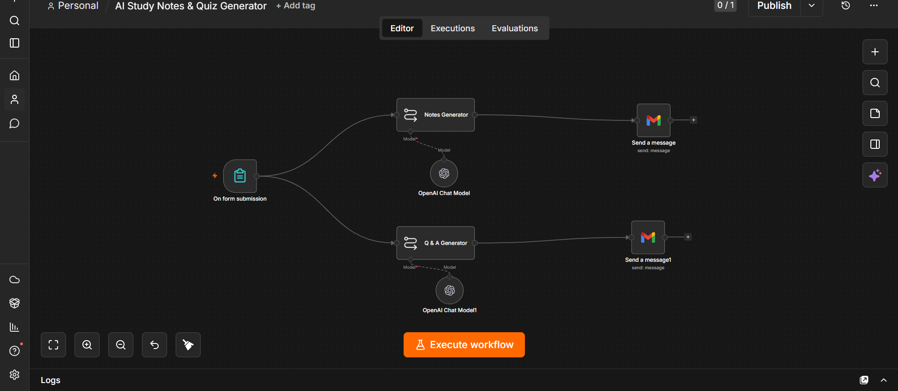
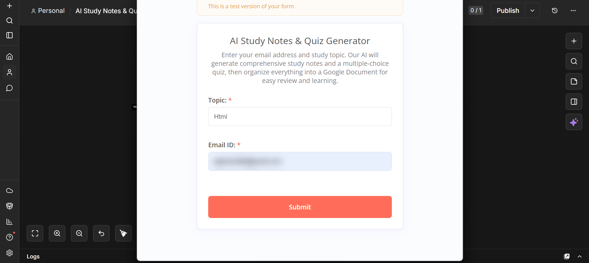
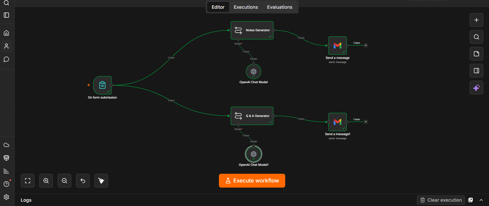
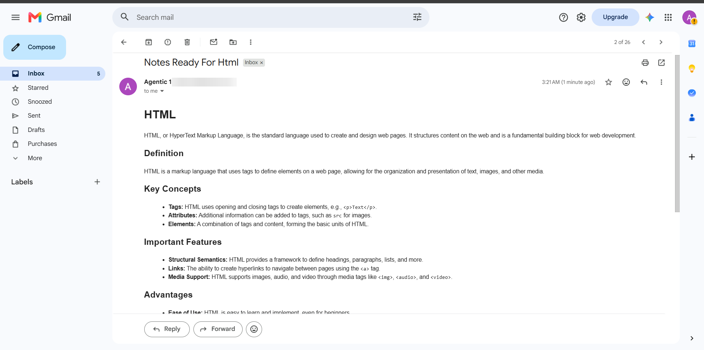
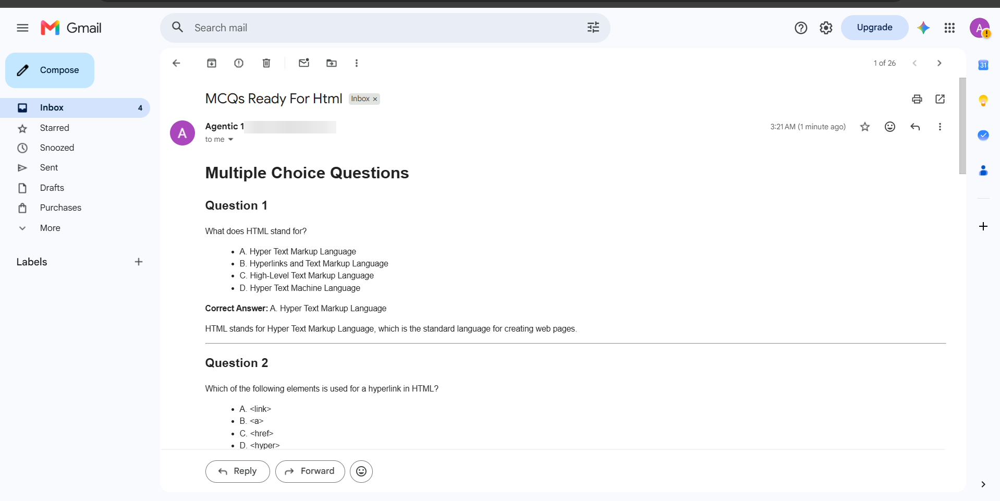
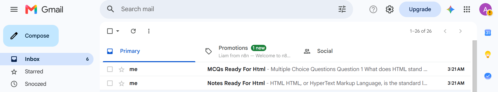

# 📚 AI Study Notes & Quiz Generator

An end-to-end **n8n** workflow that generates comprehensive study notes and a 10-question multiple-choice quiz for any topic, then emails both to the learner as two separate messages.



---

## ✨ Features

- 📝 Collects a study topic and email address through an n8n Form
- 🤖 Generates structured, AI-powered study notes
- ❓ Creates a 10-question MCQ quiz on the same topic
- 📧 Sends the notes and the quiz as **two separate emails**
- ⚡ Both AI chains run in parallel for faster results

---

## 🔄 How It Works

```text
                      ┌─► Notes Generator (LLM) ─► Gmail: Study Notes
Form Submission ──────┤
                      └─► Q & A Generator (LLM) ─► Gmail: MCQ Quiz
```

1. **On form submission** – the user submits a topic and email address.
2. **Notes Generator** – an OpenAI-powered LLM chain writes detailed study notes.
3. **Q & A Generator** – a second LLM chain creates a multiple-choice quiz.
4. **Gmail** – each output is emailed to the user separately.

---

## 🛠️ Tech Stack

| Tool | Purpose |
| --- | --- |
| n8n | Workflow automation |
| n8n Forms | User input |
| OpenAI (`gpt-4o-mini`) | Notes & quiz generation |
| Gmail | Email delivery |

---

## 📥 Setup

1. Download [`workflow.json`](workflow.json).
2. In n8n, go to **Workflows → Import from File** and select it.
3. Add your credentials:
   - **OpenAI API** for both *OpenAI Chat Model* nodes
   - **Gmail OAuth2** for both *Send a message* nodes
4. Activate the workflow and open the form URL.

### Form fields

| Field | Type |
| --- | --- |
| Topic | Text |
| Email ID | Email |

---

## 📸 Screenshots

| Submission form | Execution |
| --- | --- |
|  |  |

| Study notes email | Quiz email |
| --- | --- |
|  |  |



---

## 💡 Use Cases

- 📖 Exam preparation
- 🎓 Student self-learning
- 💼 Professional certification study
- 🧠 Interview preparation
- 🏫 Educational content generation

---

## 📜 License

This project is licensed under the [MIT License](LICENSE).
